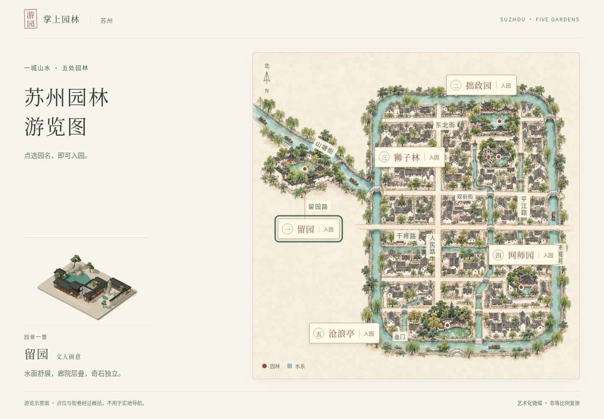
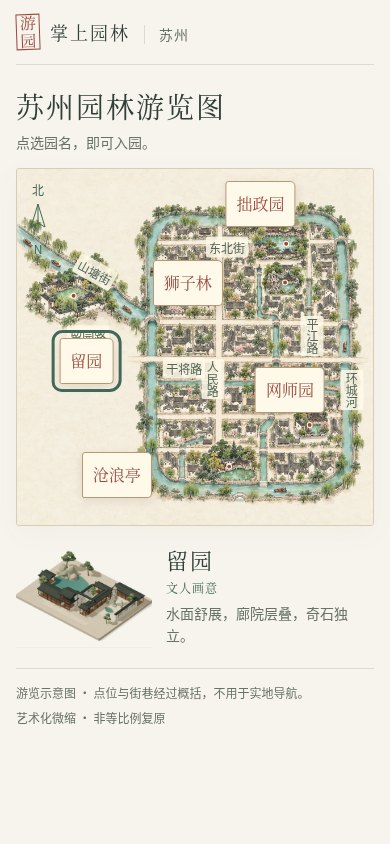

# 五园细部打磨 · 统一入口实录

2026-10-22（美国洛杉矶日期）。用户批准工具辅助精修，并明确允许本轮当前代理直接实施。实现仍位于五园各自目录；本目录只刷新五张真实园景预览、检查和分享包说明。保留原手绘风格地图插画、五处点位、正常链接及 Sites 身份/访问范围。

## 五园成果

留园与狮子林使用 Blender 4.3.2 处理各自原有自制石体，焊接、平滑、浅褶皱、减面、16 射线顶点遮蔽后导出 GLB，真实孔洞仍可穿透。网师园补窗框层次，拙政园添卷边荷叶和疏落荷花，沧浪亭加入四/六/八瓣花格漏窗。五园分别细化材质、柱缘与树冠间隙，并缓存静态阴影。没有新增跨园运行时或 npm 依赖。

| 园林 | 单元检查 | 实际浏览器检查组 | 详情与前后实图 |
| --- | --- | --- | --- |
| 留园 | 24 | 8 | [报告](../../../../liuyuan/docs/reviews/craft-1/REPORT.md) |
| 网师园 | 15 | 7 | [报告](../../../../wangshiyuan/docs/reviews/craft-1/REPORT.md) |
| 拙政园 | 15 | 7 | [报告](../../../../zhuozhengyuan/docs/reviews/craft-1/REPORT.md) |
| 狮子林 | 18 | 8 | [报告](../../../../shizilin/docs/reviews/craft-1/REPORT.md) |
| 沧浪亭 | 18 | 7 | [报告](../../../../canglangting/docs/reviews/craft-1/REPORT.md) |

合计 90 项单元检查、五园类型检查和最终生产构建全部通过；本轮五园 37 组实际浏览器检查全部通过。每园四个桌面机位前后的 position/target/zoom 完全一致；每园另有 390×844 手机视口前后截图。缩略图从新版真实画布直接复制，来源和 SHA256 见 [预览资产](preview-assets.json)。不是生成图、实物扫描或测绘复原。

## 入口与分享包

入口另外 4 组实际检查通过：五个包内链接/键盘聚焦/新版图片加载，桌面地图完整性，390px 手机/44px 点击区，320px 与 200% 文字无溢出或点位重叠。错误、失败请求和外部请求均为 0，见 [浏览器记录](browser-results.json)。五园各自的浏览器记录另覆盖真实入园、返回地图恢复选园及音乐暂停。





本轮 CloudBase 完整上传包共 31 个文件、约 7.03MB，包含五首既有音乐和两份新增石体 GLB。[测试时包内 SHA256](package-results.json) 对应实际验收内容；Git 提交后会重生成交付 ZIP 并逐文件核对内容完全一致，ZIP 时间戳不作为内容差异。生成及控制台上传步骤见 [CloudBase 说明](../../CLOUDBASE.md)。腾讯云账户未连接，未上传或声称国内线上已更新。

## 运行与复现

入口为手写静态页面，无 npm 安装或构建。`python3 -m http.server 4180 --bind 127.0.0.1 --directory dist` 可看原 Sites 链接版。完整同站点分享包先逐园 `npm ci`、`npm run build`，再从仓库根执行：

```bash
python3 suzhou-gardens/portal/scripts/package-cloudbase.py
python3 -m http.server 4195 --bind 127.0.0.1 --directory suzhou-gardens/portal/.cloudbase-runtime/upload
```

打开 http://127.0.0.1:4195/。本目录执行 `node scripts/check-craft.mjs /绝对路径/playwright/index.mjs` 可复查入口；浏览器工具路径显式提供，不是应用依赖。各园自己的 `scripts/check-craft.mjs` 复查实际渲染、触摸、阴影、音乐与地图往返。

## 验证边界

实际截图来自 Chromium 151.0.7922.173，三维使用 SwiftShader；未验证真机 GPU 帧率/发热、iOS Safari、国内网络或腾讯云线上部署。构建保留 Vite 大包提示。并行工作曾导致软件渲染和 5 秒单测超时，改为串行单工作线程、20 秒单测上限后复验通过，未减少断言/预算。未声称重跑所有历史 E2E。Sites 工具成功回执作为发布证据，不再抓取生产页面进行 QA。

只读独立审查未发现实际资产/正常发布路径阻断项。留园和狮子林在未来替换为缺少指定节点的损坏 GLB 时仍有部分分配资源未清理的边缘情况；当前提交的实际二进制均已校验稳定节点完整，故障重试检查覆盖的是请求失败。
