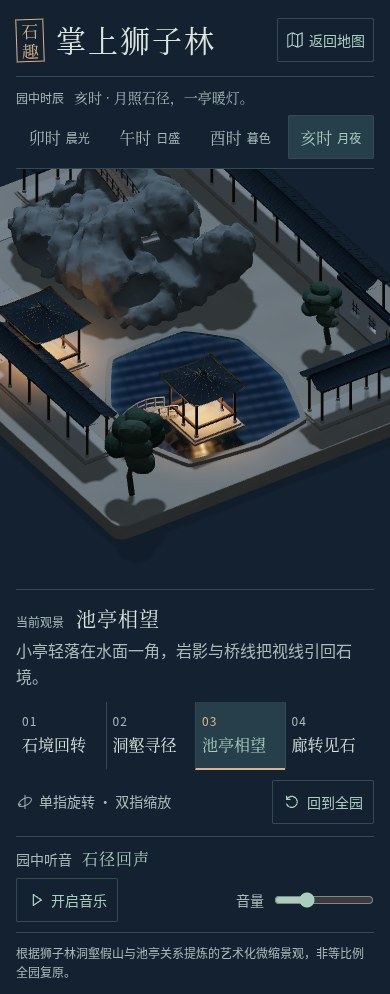

# 狮子林 · 园中时辰实录

2026-10-23 UTC。用户要求时辰效果。本轮在狮子林加入四种手动光照，其他四园不修改；入口仅更新该园当前真实预览与完整分享包。沿用用户此前允许当前代理直接实施的授权，没有冒充不可选择的 luna_worker。

## 可用体验

园景上方选择卯时·晨光、午时·日盛、酉时·暮色、亥时·月夜。实际定向光的方向、强度和色温改变，影长、受光面、池水颜色和倒影一起更新；暮色与月夜点亮六处小灯笼，两座亭另有实际暖色点光照亮地面和邻近石体。页面随时辰换纸色与文字色，原生按钮可用键盘与手机点击。

切时辰保持当前预设/自由观察方向、缩放和音乐播放，回到全园只复位相机。每次重新入园默认晨光。四种状态为艺术化光照，不是实时天文钟、季节/天气系统、日出日落计算或史实照明复原。

## 真实截图

实际 Chromium151 / SwiftShader、DPR1、减少动态效果；桌面1440×1000、手机390×844，无生成图片或后期修改。四张池亭时辰截图的 position、target、zoom 完全一致，见 browser-results.json 的 shots。默认晨光预览另有完整诊断及 SHA256。

| 时辰 | 实际池亭画面 |
| --- | --- |
| 卯时 · 晨光 | [实图](desktop-waterside-dawn.jpg) |
| 午时 · 日盛 | [实图](desktop-waterside-noon.jpg) |
| 酉时 · 暮色 | [实图](desktop-waterside-dusk.jpg) |
| 亥时 · 月夜 | [实图](desktop-waterside-night.jpg) |

月夜原四机位：[全园](desktop-overview-night.jpg)、[洞壑](desktop-rockery-night.jpg)、[池亭](desktop-waterside-night.jpg)、[曲廊](desktop-corridor-night.jpg)。

手机：[月夜全园](mobile-overview-night.jpg)、[月夜池亭](mobile-waterside-night.jpg)、[晨光池亭](mobile-waterside-dawn.jpg)。[默认晨光全页](desktop-overview-dawn.jpg)与[入口实际画布](overview-dawn-canvas.jpg)由独立捕获脚本生成。



## 检查结果

类型检查、27 项单元与最终生产构建通过，见 [build-results.json](build-results.json)；31 个生产输入和6个输出已记录SHA256并核对。没有新增依赖或锁文件改动。

[时辰专项实际浏览器检查](browser-results.json)7组通过：四种光照/固定相机/缓存与资源、月夜原四机位、自由方向/键盘/快速选择/复位、资产不重载、手机和实际音乐连续播放、320px/200%字号/横屏/44px按钮，以及同站点地图往返。入口另有4组实际检查，见 portal 对应 time-1 目录。

固定相机下切晨→午→暮→夜，实际2048²阴影绘制累计54→96→138→180，512²倒影绘制116→174→232→290，倒影捕获2→3→4→5；每次完成后计数重新稳定。GPU buffer计数保持199、framebuffer保持3，水面和场景诊断对象身份保持一致；没有重载GLB/PNG。用统一背景控制排除页面纸色差异后，真实canvas相对晨光分别有288,043/340,634/302,415个明显不同像素。不是只在画面上覆盖色片。

旧 createGarden 审计不包含本轮独立灯笼。基础园景40网格/109,106三角面，加六灯笼18网格/216三角面，共58网格/109,322三角面；加接收阴影平面，实际完整全园59网格/109,324三角面，低于原180网格、170,000三角面预算。完整实际诊断见 [preview-results.json](preview-results.json)。

本轮水面专项回归13组全部通过，涵盖实际波纹/倒影、触控/复位、媒体、布局、地图、GLB/PNG失败重试及倒影异常恢复；结果另存 water-regression.json，正常流程错误与外部请求为0，主动注入故障单独标记。最终汇总在 check-results.json；不覆盖历史water-1结果。历史八项E2E见上轮记录，本轮不宣称全部重跑。

## 运行与复现

Node.js22.12+、npm10+、WebGL2。在本园执行：

```bash
npm ci
npm run dev -- --port 5177 --strictPort
npm run typecheck
npm test -- --maxWorkers=1 --no-file-parallelism --testTimeout=20000
npm run build
npm run preview -- --port 4186 --strictPort
```

普通运行不需要 Blender。完整地图往返检查需要五园各自已有dist，从仓库根执行：

```bash
python3 suzhou-gardens/portal/scripts/package-cloudbase.py
python3 -m http.server 4206 --bind 127.0.0.1 --directory suzhou-gardens/portal/.cloudbase-runtime/upload
```

在本园执行 `TIME_ORIGIN=http://127.0.0.1:4206/shizilin/ node scripts/check-time.mjs`。相同源产物的水面专项回归可运行 `WATER_ORIGIN=http://127.0.0.1:4206/shizilin/ WATER_REVIEW_DIR=time-1 WATER_RESULTS_FILE=water-regression.json node scripts/check-water.mjs`。专项脚本使用本环境/usr/bin/chromium与本园Playwright；运行会更新本轮截图和记录。

## 限制与发布

检查是本地生产分享包上的实际Chromium/SwiftShader，不代表Safari、iOS/Android真机GPU、帧率、温度或国内网络表现。实际后台标签暂停仍受headless document.hidden不变限制；实际视口外暂停另有回归。保留Vite大包提示。四时辰为手动即时切换，没有自动时间流逝或跨页时辰记忆；不额外创建付费服务、后端或外部素材请求。

沿用现有狮子林与入口Site、源码身份及原访问范围，发布回执在deployment-results.json。CloudBase需在用户原控制台上传完整新ZIP；本地检查不等于腾讯云已经更新。运行资料与资产来源见 [ASSETS.md](ASSETS.md)。
