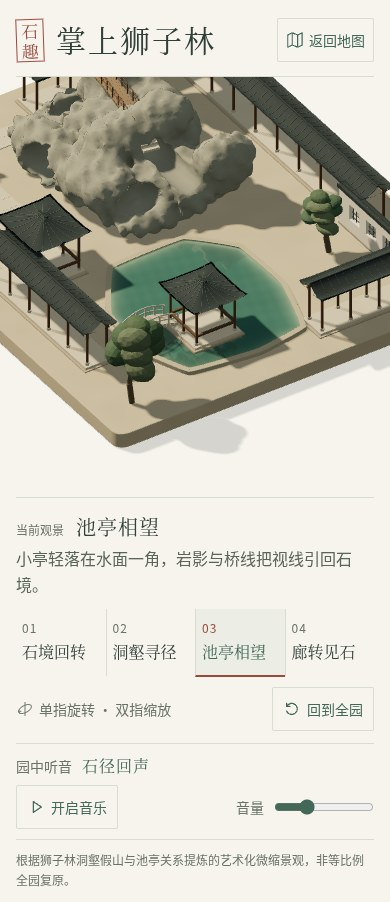

# 狮子林 · 晨光与水面样板实录

2026-10-23 UTC。用户同意先打磨狮子林“池亭相望”，本轮仅修改本园与 portal 的对应预览、检查和分享包说明。沿用此前直接实施授权，未声称使用不可选择的 luna_worker。其他四园没有本轮美术或代码改动。

## 最终变化

降低平铺式环境照明，加入暖晨光和偏冷天光，保留缓存的柔和阴影。池面使用真实正交平面倒影，倒影里有亭、石与岸线；低幅双向细波、稍柔的倒影和沿岸浅色带共同表现安静水体。删除旧的三条静态水纹线。

Blender 4.3.2 实际制作浅石褶、Smart UV、24 射线顶点遮蔽和 Cycles 1024² 切线法线烘焙。新增柱脚、屋瓦垄、檐下短椽和驳岸接缝，保持原机位、原池形、洞道与场景边界。只使用本园原创资产和本地 Three.js 着色器；没有增加 npm 依赖或锁文件变动。来源、哈希与再制作命令见 [ASSETS.md](ASSETS.md)。

## 实际检查

| 项目 | 结果与口径 |
| --- | --- |
| TypeScript / 最终构建 | 通过；最终构建包括 tsc，27 个生产输入与 6 个输出 SHA256 已固定 |
| 单元检查 | 27 项通过：布局/洞口/释放、正交倒影数学、真实岸距、实际 UV/法线、缓存隔离与地图链接 |
| 几何审计 | 40 网格、109,106 三角面，低于原 170,000 预算；坐标有限、边界符合原规格 |
| 新增实际浏览器专项 | 最终分享包产物上 13 组通过，见 [browser-results.json](browser-results.json) |
| 历史 E2E | 八项全部得到通过结果，采用首轮 5 项＋针对超时项补测 3 项；不是单次八项全绿 |
| portal | 4 组实际检查通过，记录在入口 water-1 目录 |

[完整命令、输出、最终构建指纹和分次 E2E 结果](check-results.json)保留初次失败信息。初次完整 E2E 有三项在 SwiftShader 等待时限内未完成；其中一段虚拟 200ms 时钟推进实际耗时 31.22 秒。仅调整测试的墙钟等待、让固定截图使用减少动态效果，并将截图写入新目录。保留所有机位/缩放/交互断言、虚拟时间步长和几何预算；没有 skip。相同最终生产代码下，补测三项均通过。动态水面和动态相机另有实际检查。

专项检查包含实际 WebGL 着色器与非空画面、四机位、缓存倒影和阴影、桌面/手机波纹调度、实际 IntersectionObserver 暂停/恢复、CDP 单指/双指及复位、音乐播放/暂停、同站点实际地图往返、320px/200% 字号/横屏、分别阻断 GLB 与法线 PNG 后重试，以及注入倒影绘制异常后的主场景恢复。正常流程脚本错误、失败请求、外部请求为 0；主动故障单独标记 fault。

真实离屏绘制探针记录：2048² 阴影绘制次数保持 54，512² 倒影绘制由 40 增至 200。静止波纹运行时倒影不重抓；减少动态效果且相机静止后停止重绘。只阻断倒影离屏绘制的对照图与完整画面有 4,673 个明显不同像素，确认倒影真实参与画面。12/24Hz 是定时调度上限；软件 GPU 实际帧数更低，不能当作手机 FPS。

## 真实截图

Chromium 151 / SwiftShader，DPR 1，桌面 1440×1000、手机 390×844。六组前后 position、target、zoom 完全一致，见 [before-frames.json](before-frames.json) 与 [after-frames.json](after-frames.json)。截图来自本地实际生产构建，无生成图、补绘或后期处理。截图采用减少动态效果，固定波纹相位；不是动画展示或加载性能测量。

| 视角 | 之前 | 之后 |
| --- | --- | --- |
| 全园 | [实图](before-desktop-overview.jpg) | [实图](after-desktop-overview.jpg) |
| 洞壑寻径 | [实图](before-desktop-rockery.jpg) | [实图](after-desktop-rockery.jpg) |
| 池亭相望 | [实图](before-desktop-waterside.jpg) | [实图](after-desktop-waterside.jpg) |
| 廊转见石 | [实图](before-desktop-corridor.jpg) | [实图](after-desktop-corridor.jpg) |
| 手机全园 | [实图](before-mobile-overview.jpg) | [实图](after-mobile-overview.jpg) |
| 手机池亭 | [实图](before-mobile-waterside.jpg) | [实图](after-mobile-waterside.jpg) |



## 运行与复现

Node.js 22.12+、npm 10+、WebGL 2 浏览器。在本园执行：

```bash
npm ci
npm run dev -- --port 5177 --strictPort
npm run typecheck
npm test -- --maxWorkers=1 --no-file-parallelism --testTimeout=20000
npm run build
npm run preview -- --port 4186 --strictPort
```

普通运行不需要 Blender。可选实际几何审计与生产产物专项检查：

```bash
GARDEN_REVIEW_DIR=water-1 node scripts/audit-craft.mjs
WATER_ORIGIN=http://127.0.0.1:4186/ node scripts/check-water.mjs
GARDEN_REVIEW_DIR=docs/reviews/water-1/e2e npm run test:e2e -- --timeout=240000
```

E2E 需要 Chromium，可用 PLAYWRIGHT_CHROMIUM_EXECUTABLE 指定；专项脚本使用本环境 /usr/bin/chromium。测试截图可覆盖 water-1 当前截图，不会覆盖历史 craft-1。完整同站点往返需先构建五园，在仓库根生成分享包并作为根站点预览：

```bash
python3 suzhou-gardens/portal/scripts/package-cloudbase.py
python3 -m http.server 4196 --bind 127.0.0.1 --directory suzhou-gardens/portal/.cloudbase-runtime/upload
```

随后在本园运行 `WATER_ORIGIN=http://127.0.0.1:4196/shizilin/ node scripts/check-water.mjs`，才会包含实际地图往返检查。单园 4186 预览不提供本地地图。

## 检查边界与交付

当前无真机、Safari、移动 GPU 帧率/温度或国内手机网络证据。headless Chrome 在切换标签时 document.hidden 仍为 false，故实际后台暂停未验证；源码包含可见性门控，实际离开视口暂停已验证。保留 Vite 大包提示。Blender 导出提示可选 Draco 库不可用，实际生成未压缩 GLB，无 Draco 运行时依赖，加载与洞口射线检查已通过。

旧 4195 本地端口已有异常服务，最初连接失败；本轮另起 4196 并完成真实验收。此问题不作为产品成功证据。场景仍为艺术化微缩，不是测绘或建筑复原。

沿用本园及入口既有 Site、访问范围与源仓库，发布回执单独记录 deployment-results.json。CloudBase ZIP 包含本轮最终狮子林及原有另外四园；腾讯云线上未代为上传，需用户在原环境覆盖上传完整包。
