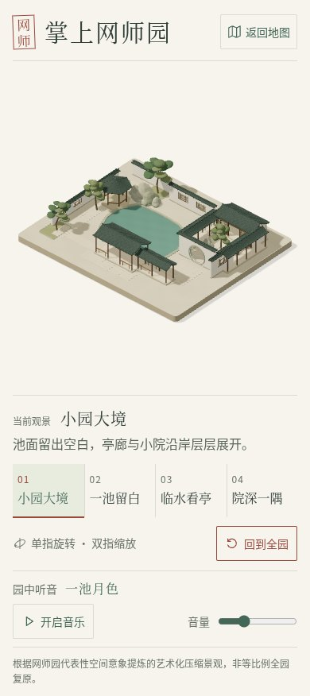

# 网师园 · 细部打磨实录

2026-10-22（美国洛杉矶日期）。用户已批准工具辅助精修，并明确允许本轮跳过当前接口无法选择的 `luna_worker`，由当前代理实施、检查和发布。没有改动工作流配置；没有声称使用该角色或验证当前代理模型运行元数据。

## 完成内容

细化窗框与内层格栅，中央开口更通透；补入檐下短椽、轻微圆角木柱及池岸材质层次。

墙、瓦、石、木与水分别设置粗糙度，使用世界坐标程序化细微色差；远处通过导数衰减细纹，避免额外贴图下载。所有灯光和场景保持静止，阴影贴图首次完成后缓存，相机移动继续重绘可见画面。原有四机位、单指旋转、双指缩放、音乐和返回地图功能保留。

几何审计：83 个网格、110,188 个三角形，低于本园既有 150,000 预算；坐标有限，包围盒见 [原始数据](geometry-results.json)。浏览器三角形计数可能包含接收阴影平面，与园景几何审计口径不同。

## 实际验证

类型检查、15 项单元检查、最终生产构建通过，记录和构建输入/输出 SHA256 见 [检查数据](check-results.json)。五园合计 90 项单元检查，本园未跳过既有断言。

浏览器在最终本地生产产物上执行 7 组检查：实际非空 WebGL 画面和着色器、四机位与静态阴影缓存、CDP 单指/双指触控及复位、静止停止重绘、真实媒体播放/暂停/音量、320px 与 200% 文字/横竖屏、返回地图恢复选园。 正常流程脚本错误、失败请求和外部请求为 0；主动故障产生的错误单独标记 `fault: true`，未作为正常成功样本。详见 [浏览器原始记录](browser-results.json)。

实际 WebGL 调用探针：切换相机前后离屏绘制次数保持 89，屏幕绘制次数由 589 增至 1649，确认相机移动复用静态阴影；这不是手机帧率测试。

## 真实截图与对照

四个桌面机位 1440×1000、手机视口 390×844、DPR 1、减少动态效果。每组前后 `position`、`target`、`zoom` 实际记录完全一致，见 [之前机位](before-frames.json) 与 [之后机位](after-frames.json)。截图来自真实 Chromium/SwiftShader WebGL，没有生成图、补绘或后期修饰。截图驱动等待诊断 ready；旧版本个别截图仍可见瞬时“正在布置”文字，不能据此当作加载耗时测量。

| 视角 | 修改前 | 修改后 |
| --- | --- | --- |
| overview | [实图](before-desktop-overview.jpg) | [实图](after-desktop-overview.jpg) |
| pool | [实图](before-desktop-pool.jpg) | [实图](after-desktop-pool.jpg) |
| pavilion | [实图](before-desktop-pavilion.jpg) | [实图](after-desktop-pavilion.jpg) |
| courtyard | [实图](before-desktop-courtyard.jpg) | [实图](after-desktop-courtyard.jpg) |
| 手机全景 | [实图](before-mobile-overview.jpg) | [实图](after-mobile-overview.jpg) |



## 复现与运行

在本园执行 `npm ci`、`npm run dev`；生产运行执行 `npm run build`、`npm run preview`。原锁文件不变，没有新增 npm 依赖。运行应用不需要 Blender。资源来源与可选制作命令见 [资产记录](ASSETS.md)。

```bash
npm run typecheck
npm run test -- --maxWorkers=1 --no-file-parallelism --testTimeout=20000
npm run build
node scripts/audit-craft.mjs
```

需要完整地图往返时，先逐园构建，再从仓库根执行 `python3 suzhou-gardens/portal/scripts/package-cloudbase.py`，以 portal/.cloudbase-runtime/upload 为 HTTP 根目录运行服务器。服务器在 4195 时，在本园执行 `node scripts/check-craft.mjs`；其他端口设置 `CRAFT_ORIGIN=http://127.0.0.1:端口`。该脚本使用本园既有 Playwright 和系统 Chromium，生成本目录的浏览器记录。

## 检查边界

软件渲染环境最初并行构建/截图时发生资源竞争与 5 秒单测超时，随后改为逐园单工作线程、单测 20 秒上限并完成复验；没有删减断言、扩大几何预算或跳过失败项。保留 Vite 大包提示。此次执行针对本轮改动的浏览器检查，没有宣称重跑全部历史 E2E。

未验证 iPhone/Android 真机、Safari、移动 GPU 帧率/温度、国内手机网络。场景保持艺术化微缩表达，未核对成测绘或建筑复原。Sites 发布结果另存 deployment-results.json；CloudBase 需在用户原账户上传完整新版包，不能把本地成功当成腾讯云已更新。
